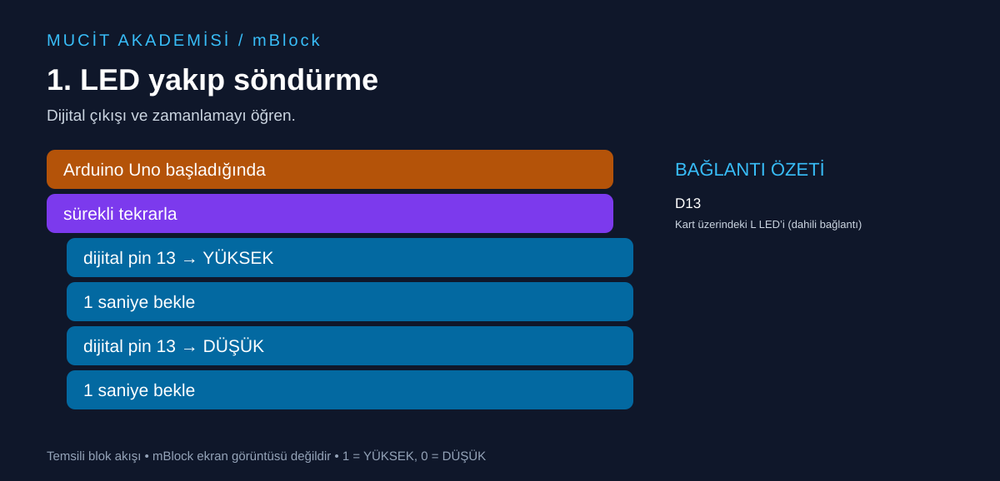

# 1. LED yakıp söndürme

Dijital çıkışı ve zamanlamayı öğren.



## Malzemeler

Arduino Uno, USB veri kablosu. Kart üzerindeki L LED’i kullanılır; harici malzeme gerekmez.

## Bağlantılar

Devreyi USB bağlantısını çıkardıktan sonra kur.

| Uno pini | Bağlantı |
|---|---|
| D13 | Kart üzerindeki L LED’i (dahili bağlantı) |

## mBlock’ta oluştur

Arduino Uno cihazını seç, Upload/Yükle moduna geç. Aşağıdaki temsili akışı cihazın başlangıç, kontrol, pin okuma/yazma ve işlem bloklarıyla kur. Etiketler dil ve cihaz uzantısı sürümüne göre değişebilir; buradaki metin bire bir menü adı değildir.

```text
Arduino Uno başladığında
sürekli tekrarla
  dijital pin 13 → YÜKSEK
  1 saniye bekle
  dijital pin 13 → DÜŞÜK
  1 saniye bekle
```

Yükle düğmesini kullan.

## Beklenen sonuç

L LED’i 1 saniye yanar, 1 saniye söner.

## Dikkat ve hata ayıklama

Harici LED kullanacaksan D13 → 330 Ω direnç → LED anot (+), LED katot (−) → GND bağlantısını kur.

## Kendin dene

Bekleme sürelerini 0,2 saniye yap. Sonra yanma süresini 2, sönme süresini 0,5 saniye yap.

## Arduino karşılığı

[Arduino IDE ile açılabilir .ino kodu](01-led-yanip-sonme.ino). Bu dosya mBlock proje dosyası değildir; algoritmayı metin koduyla karşılaştırmak içindir.
