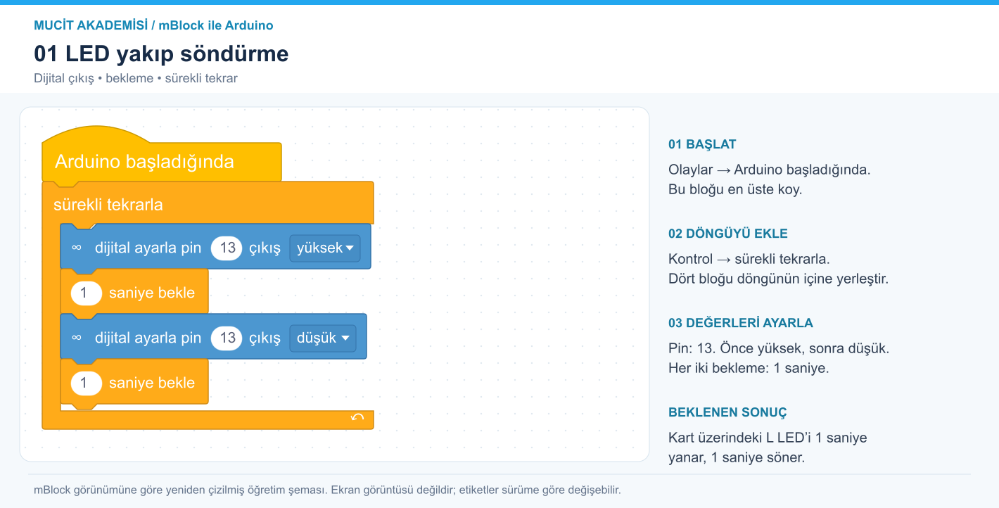

# 1. LED yakıp söndürme

Dijital çıkışı ve zamanlamayı öğren.



[Ölçeklenebilir SVG görseli](../../gorseller/01-led-yanip-sonme.svg)

## Malzemeler

Arduino Uno, USB veri kablosu. Kart üzerindeki L LED’i kullanılır; harici malzeme gerekmez.

## Bağlantılar

Devreyi USB bağlantısını çıkardıktan sonra kur.

| Uno pini | Bağlantı |
|---|---|
| D13 | Kart üzerindeki L LED’i (dahili bağlantı) |

## mBlock’ta oluştur

Arduino Uno cihazını seç ve Upload/Yükle moduna geç. Görsel, mBlock’un renkleri, bağlantı çentikleri ve iç içe blok yerleşimi esas alınarak yeniden çizilmiştir; uygulama ekran görüntüsü değildir. Türkçe etiketler kurulu sürüme göre küçük farklılıklar gösterebilir.

Olaylar kategorisinden başlangıç bloğunu al. Kontrol kategorisindeki sürekli tekrarla bloğunu altına bağla. İki mavi pin ayarlama bloğunu ve iki turuncu bekleme bloğunu görseldeki sırayla döngünün içine tak. Pin alanlarını 13; açılır çıkış alanlarını sırasıyla yüksek ve düşük yap.

Aşağıdaki metin, görselin okunabilir dökümüdür. Yuvarlak parantezler sayı/değer yuvalarını, köşeli parantezler açılır seçimleri, açılı parantezler koşul yuvasını temsil eder; bunları mBlock’a metin olarak yapıştırma.

```text
Arduino başladığında
  sürekli tekrarla
    dijital ayarla pin (13) çıkış [yüksek]
    (1) saniye bekle
    dijital ayarla pin (13) çıkış [düşük]
    (1) saniye bekle
```

Yükle düğmesini kullan.

## Beklenen sonuç

L LED’i 1 saniye yanar, 1 saniye söner.

## Dikkat ve hata ayıklama

Harici LED kullanacaksan D13 → 330 Ω direnç → LED anot (+), LED katot (−) → GND bağlantısını kur.

## Kendin dene

Bekleme sürelerini 0,2 saniye yap. Sonra yanma süresini 2, sönme süresini 0,5 saniye yap.

## Arduino karşılığı

[Arduino IDE ile açılabilir .ino kodu](01-led-yanip-sonme.ino). Bu dosya mBlock proje dosyası değildir; algoritmayı metin koduyla karşılaştırmak içindir.
