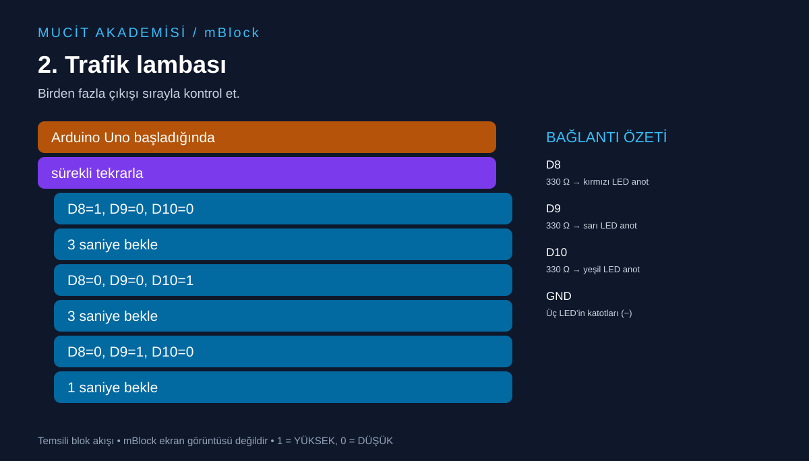

# 2. Trafik lambası

Birden fazla çıkışı sırayla kontrol et.



## Malzemeler

Arduino Uno, breadboard, kırmızı/sarı/yeşil LED, her LED için ayrı 330 Ω direnç, jumper kablolar.

## Bağlantılar

Devreyi USB bağlantısını çıkardıktan sonra kur.

| Uno pini | Bağlantı |
|---|---|
| D8 | 330 Ω → kırmızı LED anot |
| D9 | 330 Ω → sarı LED anot |
| D10 | 330 Ω → yeşil LED anot |
| GND | Üç LED’in katotları (−) |

## mBlock’ta oluştur

Arduino Uno cihazını seç, Upload/Yükle moduna geç. Aşağıdaki temsili akışı cihazın başlangıç, kontrol, pin okuma/yazma ve işlem bloklarıyla kur. Etiketler dil ve cihaz uzantısı sürümüne göre değişebilir; buradaki metin bire bir menü adı değildir.

```text
Arduino Uno başladığında
sürekli tekrarla
  D8=1, D9=0, D10=0
  3 saniye bekle
  D8=0, D9=0, D10=1
  3 saniye bekle
  D8=0, D9=1, D10=0
  1 saniye bekle
```

Yükle düğmesini kullan.

## Beklenen sonuç

Kırmızı 3 saniye, yeşil 3 saniye, sarı 1 saniye yanar; döngü tekrarlanır.

## Dikkat ve hata ayıklama

Bu, sınıf içi sıralama örneğidir; gerçek yol sinyalizasyonu tasarımı değildir. Her LED’in kendi direnci olmalı.

## Kendin dene

Kırmızı ışığı 5 saniye yap. Her aşamada yalnız bir LED’in yandığını kontrol et.

## Arduino karşılığı

[Arduino IDE ile açılabilir .ino kodu](02-trafik-lambasi.ino). Bu dosya mBlock proje dosyası değildir; algoritmayı metin koduyla karşılaştırmak içindir.
