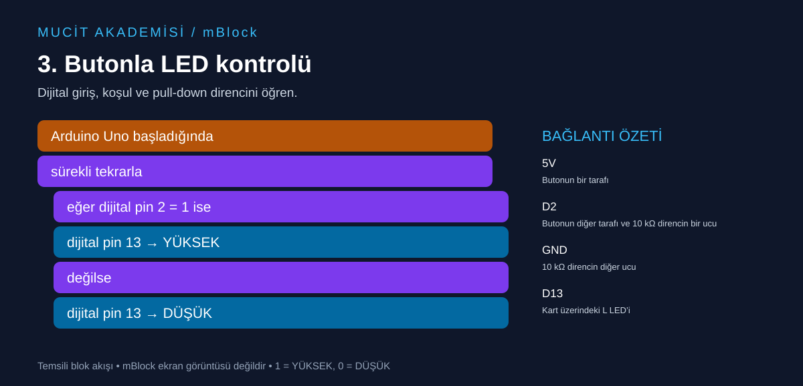

# 3. Butonla LED kontrolü

Dijital giriş, koşul ve pull-down direncini öğren.



## Malzemeler

Arduino Uno, breadboard, buton, 10 kΩ direnç, jumper kablolar. Çıkış için kartın L LED’i.

## Bağlantılar

Devreyi USB bağlantısını çıkardıktan sonra kur.

| Uno pini | Bağlantı |
|---|---|
| 5V | Butonun bir tarafı |
| D2 | Butonun diğer tarafı ve 10 kΩ direncin bir ucu |
| GND | 10 kΩ direncin diğer ucu |
| D13 | Kart üzerindeki L LED’i |

## mBlock’ta oluştur

Arduino Uno cihazını seç, Upload/Yükle moduna geç. Aşağıdaki temsili akışı cihazın başlangıç, kontrol, pin okuma/yazma ve işlem bloklarıyla kur. Etiketler dil ve cihaz uzantısı sürümüne göre değişebilir; buradaki metin bire bir menü adı değildir.

```text
Arduino Uno başladığında
sürekli tekrarla
  eğer dijital pin 2 = 1 ise
    dijital pin 13 → YÜKSEK
  değilse
    dijital pin 13 → DÜŞÜK
```

Yükle düğmesini kullan.

## Beklenen sonuç

Butona basılıyken L LED’i yanar; bırakınca söner.

## Dikkat ve hata ayıklama

Dört bacaklı butonda aynı taraftaki iki bacak genellikle zaten bağlıdır. Bağlantıyı ölçerek doğrula; butonu breadboard’un orta kanalına yerleştir. Giriş boşta kalmasın. Bu basılı tutma örneğinde kenar sayımı yoktur; sayaç yaparsan kontak sıçramasını ayrıca ele almalısın.

## Kendin dene

Koşulun iki kolundaki LED değerlerini değiştirerek davranışı tersine çevir.

## Arduino karşılığı

[Arduino IDE ile açılabilir .ino kodu](03-buton-led.ino). Bu dosya mBlock proje dosyası değildir; algoritmayı metin koduyla karşılaştırmak içindir.
