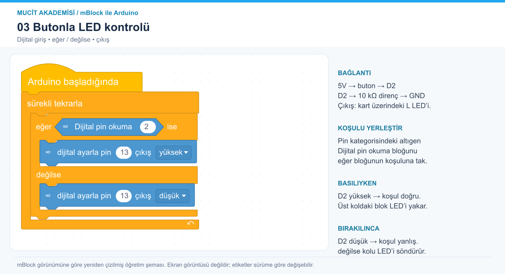

# 3. Butonla LED kontrolü

Dijital giriş, koşul ve pull-down direncini öğren.



[Ölçeklenebilir SVG görseli](../../gorseller/03-buton-led.svg)

## Malzemeler

Arduino Uno, breadboard, buton, 10 kΩ direnç, jumper kablolar. Çıkış için kartın L LED’i.

## Bağlantılar

Devreyi USB bağlantısını çıkardıktan sonra kur.

| Uno pini | Bağlantı |
|---|---|
| 5V | Butonun bir tarafı |
| D2 | Butonun diğer tarafı ve 10 kΩ direncin bir ucu |
| GND | 10 kΩ direncin diğer ucu |
| D13 | Kart üzerindeki L LED’i |

## mBlock’ta oluştur

Arduino Uno cihazını seç ve Upload/Yükle moduna geç. Görsel, mBlock’un renkleri, bağlantı çentikleri ve iç içe blok yerleşimi esas alınarak yeniden çizilmiştir; uygulama ekran görüntüsü değildir. Türkçe etiketler kurulu sürüme göre küçük farklılıklar gösterebilir.

Kontrol kategorisindeki eğer/değilse bloğunu döngünün içine koy. Pin kategorisindeki altıgen Dijital pin okuma bloğunu koşul yuvasına tak ve pin değerini 2 yap. Bu altıgen blok yüksek seviyede doğru, düşük seviyede yanlış koşulu verir. İki pin ayarlama bloğunu sırasıyla eğer ve değilse kollarına yerleştir.

Aşağıdaki metin, görselin okunabilir dökümüdür. Yuvarlak parantezler sayı/değer yuvalarını, köşeli parantezler açılır seçimleri, açılı parantezler koşul yuvasını temsil eder; bunları mBlock’a metin olarak yapıştırma.

```text
Arduino başladığında
  sürekli tekrarla
    eğer <Dijital pin okuma (2)> ise
      dijital ayarla pin (13) çıkış [yüksek]
    değilse
      dijital ayarla pin (13) çıkış [düşük]
```

Yükle düğmesini kullan.

## Beklenen sonuç

Butona basılıyken L LED’i yanar; bırakınca söner.

## Dikkat ve hata ayıklama

Dört bacaklı butonda aynı taraftaki iki bacak genellikle zaten bağlıdır. Bağlantıyı ölçerek doğrula; butonu breadboard’un orta kanalına yerleştir. Giriş boşta kalmasın. Bu basılı tutma örneğinde kenar sayımı yoktur; sayaç yaparsan kontak sıçramasını ayrıca ele almalısın.

## Kendin dene

Koşulun iki kolundaki LED değerlerini değiştirerek davranışı tersine çevir.

## Arduino karşılığı

[Arduino IDE ile açılabilir .ino kodu](03-buton-led.ino). Bu dosya mBlock proje dosyası değildir; algoritmayı metin koduyla karşılaştırmak içindir.
