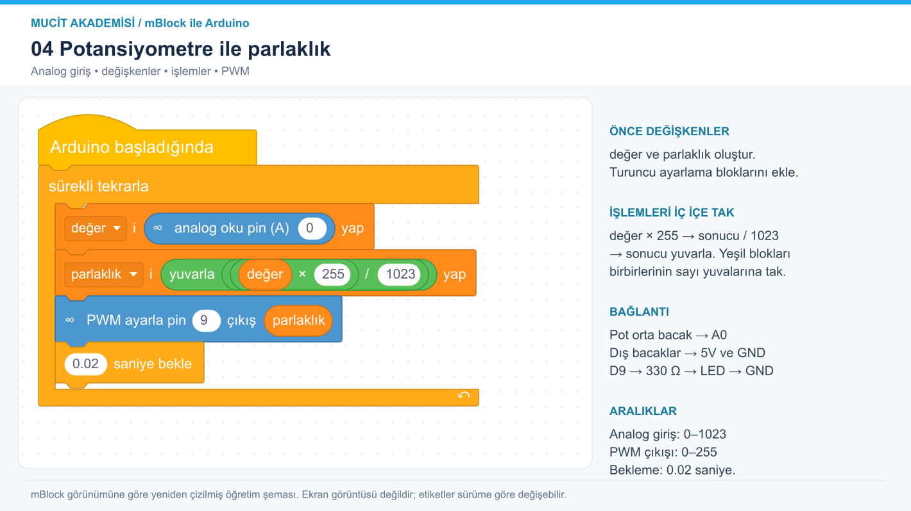

# 4. Potansiyometre ile parlaklık

Analog okuma ile PWM çıkışının aralıklarını eşleştir.



[Ölçeklenebilir SVG görseli](../../gorseller/04-potansiyometre-pwm.svg)

## Malzemeler

Arduino Uno, 10 kΩ potansiyometre, LED, 330 Ω direnç, breadboard ve jumper kablolar.

## Bağlantılar

Devreyi USB bağlantısını çıkardıktan sonra kur.

| Uno pini | Bağlantı |
|---|---|
| 5V | Potansiyometrenin bir dış bacağı |
| GND | Potansiyometrenin diğer dış bacağı ve LED katodu |
| A0 | Potansiyometrenin orta bacağı |
| D9 (~PWM) | 330 Ω → LED anot |

## mBlock’ta oluştur

Arduino Uno cihazını seç ve Upload/Yükle moduna geç. Görsel, mBlock’un renkleri, bağlantı çentikleri ve iç içe blok yerleşimi esas alınarak yeniden çizilmiştir; uygulama ekran görüntüsü değildir. Türkçe etiketler kurulu sürüme göre küçük farklılıklar gösterebilir.

Değişkenler kategorisinde değer ve parlaklık oluştur. İlk değişken ayarlama bloğunun değer yuvasına mavi analog okuma bloğunu tak; analog pin alanına 0 yaz (A0). İşlemler kategorisinde çarpma bloğuna değer ve 255; bölme bloğuna çarpmanın sonucu ve 1023 yerleştir. Bölme bloğunu yuvarla bloğunun içine, bu sonucu parlaklık ayarlama bloğuna tak. PWM bloğunun çıkış yuvasına parlaklık değişkenini yerleştir. Bekleme alanına 0.02 yaz.

Aşağıdaki metin, görselin okunabilir dökümüdür. Yuvarlak parantezler sayı/değer yuvalarını, köşeli parantezler açılır seçimleri, açılı parantezler koşul yuvasını temsil eder; bunları mBlock’a metin olarak yapıştırma.

```text
Arduino başladığında
  sürekli tekrarla
    [değer] i (analog oku pin (A) (0)) yap
    [parlaklık] i (yuvarla (((değer) × (255)) / (1023))) yap
    PWM ayarla pin (9) çıkış (parlaklık)
    (0.02) saniye bekle
```

Yükle düğmesini kullan.

## Beklenen sonuç

Potansiyometre çevrildikçe harici LED’in parlaklığı değişir.

## Dikkat ve hata ayıklama

Uno’da analog giriş 0–1023, PWM yazma değeri 0–255 aralığındadır. D9 PWM destekler. PWM gerçek analog voltaj çıkışı değildir; çıkış hızlı açılıp kapanır. Yuvarlama bloğu yoksa bu pozitif aralıkta aşağı yuvarlama da kullanılabilir.

## Kendin dene

Parlaklığı 255 − parlaklık olarak hesaplayıp dönüş yönünü tersine çevir.

## Arduino karşılığı

[Arduino IDE ile açılabilir .ino kodu](04-potansiyometre-pwm.ino). Bu dosya mBlock proje dosyası değildir; algoritmayı metin koduyla karşılaştırmak içindir.
