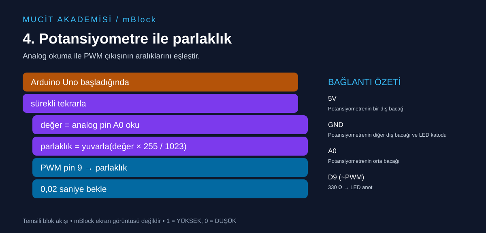

# 4. Potansiyometre ile parlaklık

Analog okuma ile PWM çıkışının aralıklarını eşleştir.



## Malzemeler

Arduino Uno, 10 kΩ potansiyometre, LED, 330 Ω direnç, breadboard ve jumper kablolar.

## Bağlantılar

Devreyi USB bağlantısını çıkardıktan sonra kur.

| Uno pini | Bağlantı |
|---|---|
| 5V | Potansiyometrenin bir dış bacağı |
| GND | Potansiyometrenin diğer dış bacağı ve LED katodu |
| A0 | Potansiyometrenin orta bacağı |
| D9 (~PWM) | 330 Ω → LED anot |

## mBlock’ta oluştur

Arduino Uno cihazını seç, Upload/Yükle moduna geç. Aşağıdaki temsili akışı cihazın başlangıç, kontrol, pin okuma/yazma ve işlem bloklarıyla kur. Etiketler dil ve cihaz uzantısı sürümüne göre değişebilir; buradaki metin bire bir menü adı değildir.

```text
Arduino Uno başladığında
sürekli tekrarla
  değer = analog pin A0 oku
  parlaklık = yuvarla(değer × 255 / 1023)
  PWM pin 9 → parlaklık
  0,02 saniye bekle
```

Önce `değer` ve `parlaklık` adlı değişkenleri oluştur. PWM alanına parlaklık değişkenini yerleştir.

Yükle düğmesini kullan.

## Beklenen sonuç

Potansiyometre çevrildikçe harici LED’in parlaklığı değişir.

## Dikkat ve hata ayıklama

Uno’da analog giriş 0–1023, PWM yazma değeri 0–255 aralığındadır. D9 PWM destekler. PWM gerçek analog voltaj çıkışı değildir; çıkış hızlı açılıp kapanır. Yuvarlama bloğu yoksa bu pozitif aralıkta aşağı yuvarlama da kullanılabilir.

## Kendin dene

Parlaklığı 255 − parlaklık olarak hesaplayıp dönüş yönünü tersine çevir.

## Arduino karşılığı

[Arduino IDE ile açılabilir .ino kodu](04-potansiyometre-pwm.ino). Bu dosya mBlock proje dosyası değildir; algoritmayı metin koduyla karşılaştırmak içindir.
